# SISTEMA DE LOJA VIRTUAL SIMPLIFICADA

## Descrição
O projeto Sistema de Loja Virtual Simplificada possibilita que um cliente cadastre-se ao informar alguns dados pessoais para fornecer a capacidade de adicionar produtos da loja dentro de um carrinho virtual, depois efetuar um pedido de pagamento, o qual pode receber descontos por cupons ou acréscimos devido ao frete. Por fim, o cliente recebe uma nota fiscal, enquanto o dono da loja tem acesso a um relatório das vendas.

## Objetivo
Criar um sistema que facilite o comércio físico e virtual ao automatizar, organizar e otimizar várias etapas de uma transação comercial, como a criação de relatórios de venda, a realização do pedido de compra e o pagamento e a alocação de produtos no carrinho. Assim, o sistema facilita a compra pelos clientes e a organização do comércio pelo comerciante.

## Indice

[🔗](#como-acessar-o-projeto) Como acessar o projeto?

[🔗](#como-utilizar-a-api) Como utilizar a API?


# Como acessar o projeto?

## 1. Clonar o repositório

Execute no terminal o comando:

```bash
git clone https://github.com/GuilhermeZdA/loja-virtual.git
```

para salvar uma cópia do projeto na sua máquina. Em seguida, entre no repositório pela sua IDE (VSCODE).


## 2. Instalar dependências

FastAPI: Utilizada para criar a API do sistema e configurar suas rotas.
Uvicorn: Utilizada para executar um servidor web onde a API vai funcionar.
Pydantic: Utilizada para facilitar a validação dos dados na API.

Execute no terminal os comandos:

```bash
pip install fastapi
```
```bash
pip install uvicorn
```
```bash
pip install pydantic
```

## 3. Iniciar o servidor

Há duas formas para inicializar o servidor do Uvicorn:

#### 1. Comando do Uvicorn no terminal

```bash
uvicorn src.api.main:app --reload
```
<br>

#### 2. Executando o arquivo run.py

- Windows
```bash
python run.py
```
- Linux ou macOS
```bash
python3 run.py
```
<br>

**OBS**: Caso precise encerrar o servidor, execute o comando Ctrl + C no terminal ou apague o terminal. A página do SWAGGER não funcionará até que o servidor seja inicializado novamente e a página seja atualizada.

## 4. Acessando a página da API

Com o servidor do Uvicorn inicializado, acesse esse link:

**http://127.0.0.1:8000/docs**

para acessar a documentação interativa da API (Swagger)

## 5. Visão da API

Numa análise superficial, a página da API apresenta título, versão, descrição da API, os recursos (Produto, Cliente, etc) e no final 'Schemas'.

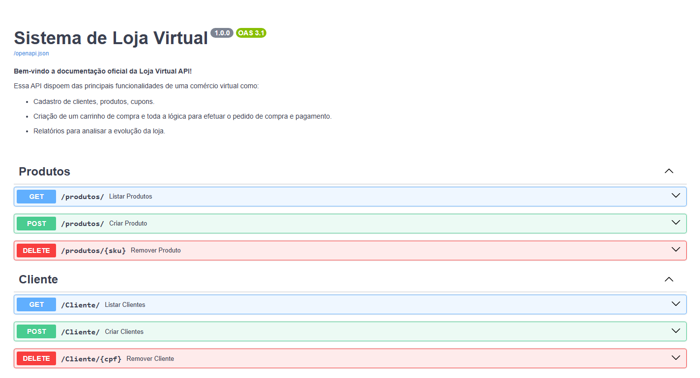

# Como utilizar a API?

1. Escolha um recurso da API e uma de suas ações.

No exemplo será selecionado o Get do Cupom.

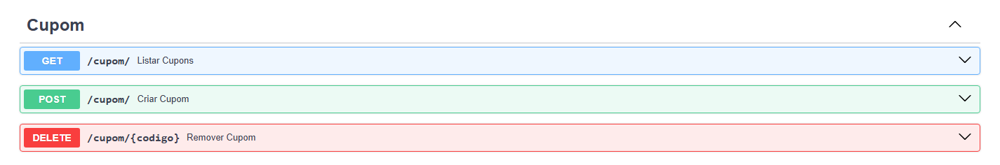

2. Selecione a opção "Try it out"

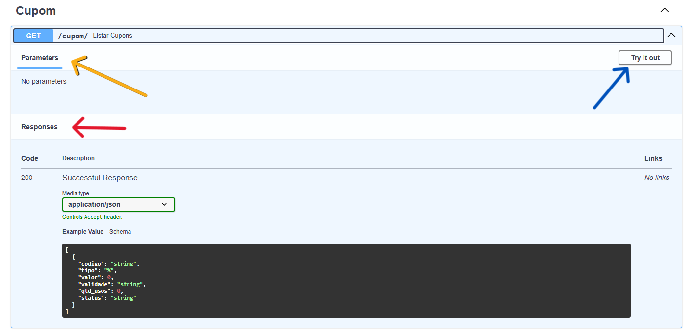

🟨: Parameters são as dados inseridos pelo usuário, nesse exemplo o usuário não precisa inserir informações.

🟥: Responses são as respostas da API em caso de sucesso ou de falha. Em caso de erro, uma mensagem especificando o que ocorreu é exibida. 

🟦: Try it Out habilita a execução da função, edição de parametros e do Request Body.

3. Selecione a opção "Execute"

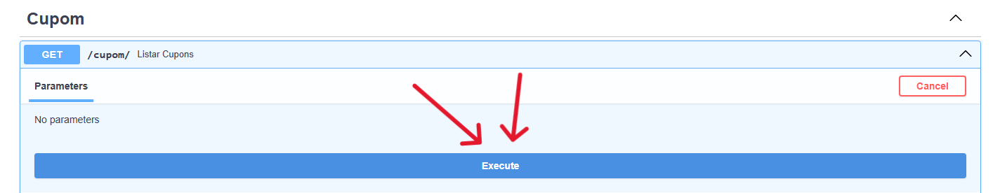

4. Veja os resultados no "Response body"

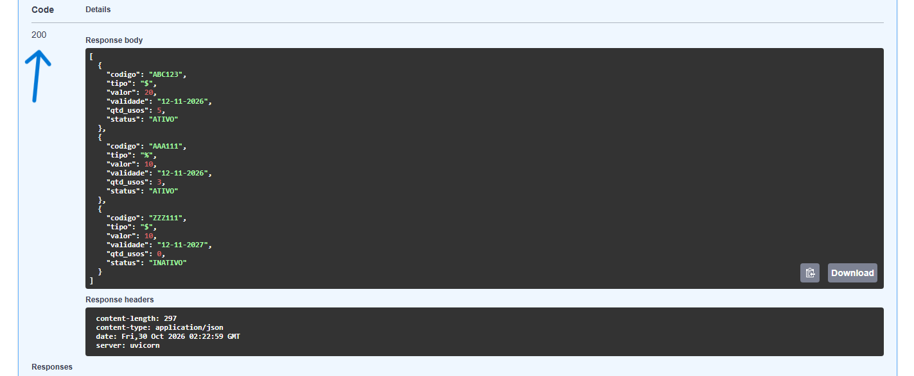

🟦: Code 200 representando um sucesso

## Dicas e casos especificos

No geral, esses 4 passos são suficientes para executar o método Get dos recursos, mas para executar o Post, Delete e Patch há algumas pequenas diferenças.

### Parametros
---
Alguns métodos exigem que parametros sejam inseridos. Uma caixa de entrada (input) será exibida quando parametros forem exigidos.

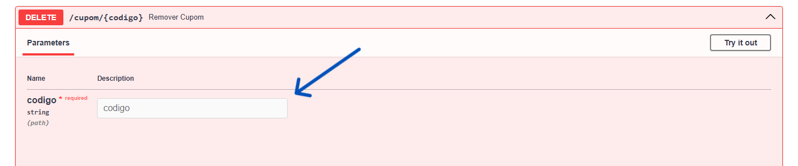


### Request Body
---
Para analisar a API, o Request Body aceita dados para simular seu funcionamento

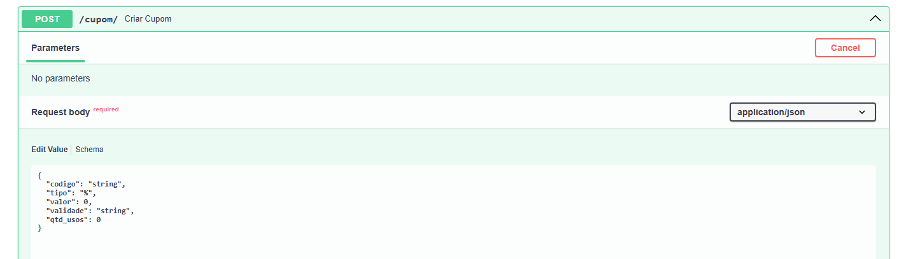

Nesse exemplo, o POST do recurso Cupom recebe diversos dados. Um deles é o código do cupom, representado abaixo:
```python
{"codigo" : "string"}
```

O nome escrito na esquerda ("codigo") nunca deve ser alterado. Já o nome na direita ("string") deve ser alterado no formato válido de cada atributo.
```python
{"codigo" : "CUPOM20"}
```

### Schema
---
Em baixo do Resquest Body, há dois nomes: Edit Value e Schema. Selecione Schema para acessar a descrição de cada atributo. As descrições são curtas e podem conter:
- Explicação sobre o que é atributo.
- Especificação de critérios de validação.
- Exemplos.
- Um enum contendo os valores aceitos.

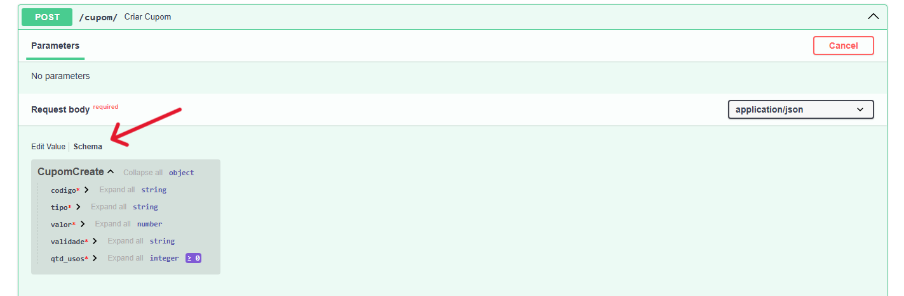


# Fluxo operacional

## 1. Cadastro de entidades

O primeiro passo do sistema é o cadastro de clientes, produtos e cupons. Essas são as entidades básicas do sistema e são necessárias para realizar as próximas ações.


## 2. Criação do Carrinho de Compras

O cliente cadastrado no sistema pode informar seu CPF, a quantidade e o SKU do produto que ela deseja adicionar ao carrinho. Após criar um carrinho, você pode exibi-lo fornecendo o CPF cadastrado nele, exclui-lo por inteiro ou retirar apenas produtos específicos.

**OBS**: O carrinho diferentemente das outros dados, não é armazenado em uma banco de dados, com o intuito de simular um Local Storage. Então caso o servidor reinicie ou ocorra algum erro, os dados dos carrinhos serão **APAGADOS**. Transforme-os em pedidos para evitar que isso aconteça.

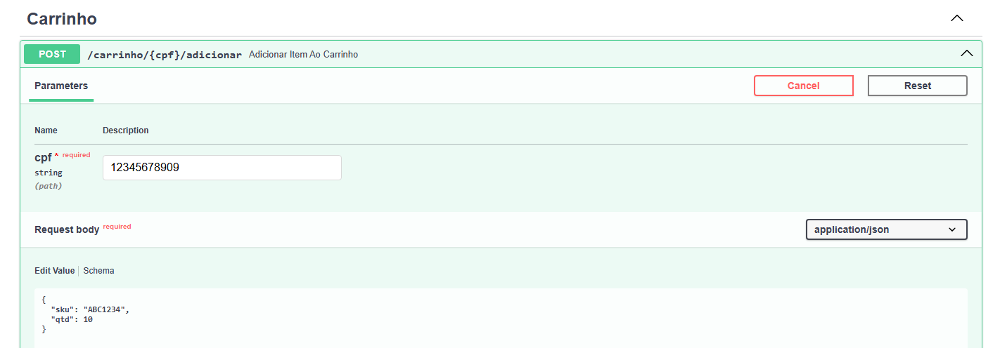

## 3. Criação do Pedido

O Pedido é uma dos recursos mais importantes e complexos da API. Inicialmente ele utiliza os dados do carrinho, cliente, cupom para calcular preço total, descontos do cupom, acréscismo do frete, data de criação do pedido e armazenas outras informações.

O pedido pode seguir esses fluxos:

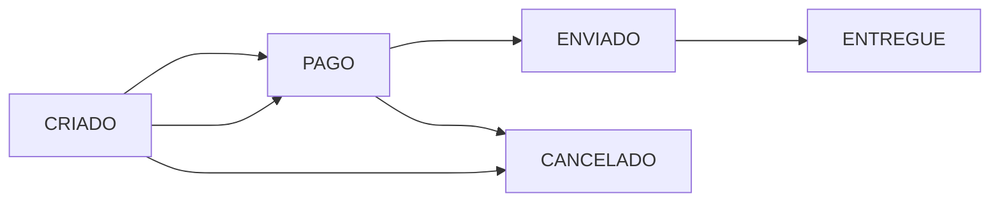

Para criar o pedido é necessário informar o CPF que foi informado no carrinho e o código do cupom no POST.

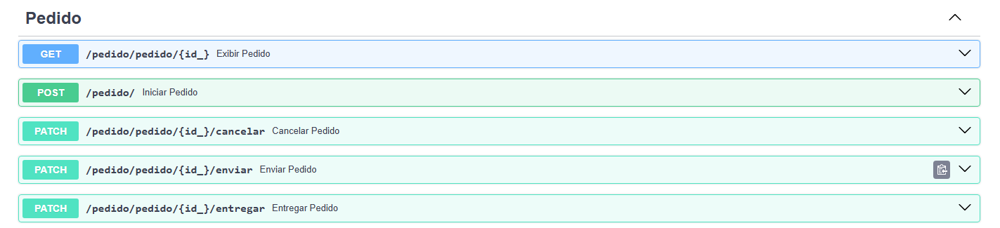

**OBS**: Caso o código do cupom não seja informado, digite **null** onde o código seria informado.

```python
{
"cpf": 12345678909,
"cod_cupom": null
}
```

## 4. Efetuar o pagamento

Após a criação do pedido, o próximo passo é o cliente efetuar o pagamento. O valor do pagamento deve ser **igual** ao valor total do pedido, além disso uma nota fiscal será gerada, armazenando alguns dados do pagamento. A nota fiscal também segue um fluxo que depende do cancelamento do pedido.

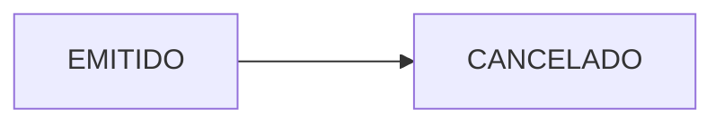

## 5. Envio, Entrega e Cancelamento do Pedido

O pedido pode ser cancelado, enviado ou entregue. Para realizar essas mudanças, é necessário informar o ID do pedido gerado ao inicia-lo.

* CANCELADO: Bloqueia mudanças no pedido.
* ENVIADO: O produto vai ser enviado, gera um código de rastreio.
* ENTREGUE: O produto foi entregue no destino, gera uma data de entrega.

A mudança desses estados devem seguir o caminho do [fluxograma](#3-criação-do-pedido).

## 6. Relatórios

O recurso Relatórios oferece 3 tipos diferentes de análise de dados da loja:

* Relatório dos pedidos: Informa a quantidade/porcentagem de pedidos em cada um de seus estados.
* Faturamento e Ticket médio: Informa o faturamento total da loja, a quantidade de vendas finalizadas e o valor médio de cada venda. 
* Ranking dos produtos: Informa quais foram os produtos mais vendidos da loja.

# Lista das classes
1. Cliente
2. Produto
3. ProdutoDigital
4. ProdutoFisico
5. ItemCarrinho
6. Carrinho
7. Pedido
8. ItemPedido
9. Cupom
10. Pagamento
11. NotaFiscal
12. Relatorio
13. Endereco
14. Frete

# Diagrama de classes

### **Para uma visão mais detalhada, o [link](https://miro.com/app/board/uXjVHjQXB5Y=/?share_link_id=994540664978) de acesso do diagrama pelo Miro.**

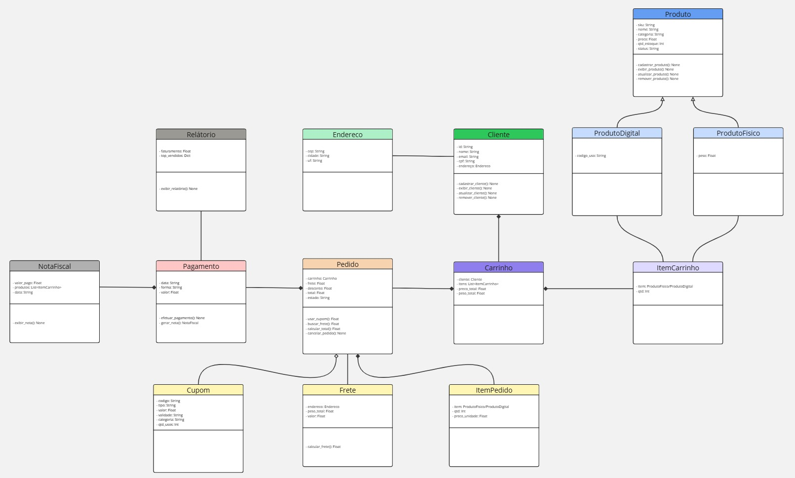

# Classes detalhadas

- ## Cliente
    ### Atributos
    - id
    - nome
    - categoria
    - email
    - cpf
    - endereço (CEP, Cidade, UF)

    ### Métodos
    - cadastrar_cliente()
    - exibir_cliente()
    - atualizar_cliente()
    - remover_cliente()

- ## Produto
    ### Atributos
    - sku
    - nome
    - categoria
    - preço_unidade (>0)
    - qtd_stoque (>=0)
    - status

    ### Métodos
    - cadastrar_produto()
    - exibir_produto()
    - atualizar_produto()
    - remover_produto()

- ## ProdutoDigital
    ProdutoDigital -> Produto
    ### Atributos
    - codigo_uso

- ## ProdutoFisico
    ProdutoFisico -> Produto
    ### Atributos
    - peso

- ## ItemCarrinho
    ### Atributos
    - item
    - qtd

- ## Carrinho
    ### Atributos
    - cliente
    - itens
    - preco_total
    - peso_total

    ### Métodos
    - adicionar_carrinho()
    - remover_carrinho()
    - alterar_qtd_itens()

- ## Pedido
    ### Atributos
    - carrinho
    - frete
    - desconto
    - total
    - estado (CRIADO, PAGO, ENVIADO, ENTREGUE, CANCELADO)

    ### Métodos
    - cancelar_pedido() (somente se CRIADO ou PAGO)
    - buscar_frete()
    - usar_cupom()
    - calcular_total()

- ## ItemPedido
    ### Atributos
    - item
    - qtd
    - preco_unidade

- ## Cupom
    ### Atributos
    - codigo
    - tipo (Valor/Percentual)
    - valor
    - validade
    - categoria
    - qtd_usos

- ## Pagamento
    ### Atributos
    - data
    - forma (PIX, CREDITO, DEBITO, BOLETO)
    - valor

    ### Métodos
    - efetuar_pagamento() (Mudar o estado do Pedido para Pago)
    - gerar_nota()

- ## NotaFiscal
    ### Atributos
    - valor_pago
    - produtos
    - data
    
    ### Métodos
    - exibir_nota()

- ## Relatorio
    ### Atributos
    - faturamento
    - top_vendidos

    ### Métodos
    - exibir_relatório()

- ## Endereco
    ### Atributos
    - cep
    - cidade
    - uf

- ## Frete
    ### Atributos
    - endereco
    - peso_total
    - valor

    ### Métodos
    - calcular_frete()